# GitOps Delivery for the Core API

## Overview

Implemented portfolio application and delivery configuration. **AWS/ECR and Argo CD integration is not yet deployed.** No production availability or recovery claims are made. See [validation evidence](docs/validation.md).

## Architecture

[Application repository](https://github.com/expertnafees-hub/gitops-core-api) owns source, container build and CI. [GitOps repository](https://github.com/expertnafees-hub/gitops-platform-config) owns the chart, environment values and Argo CD definitions. An explicitly dispatched release builds once, scans, publishes, then opens a development promotion PR.

## Architecture Diagram

```mermaid
flowchart LR
    Source["Reviewed source"] --> Test["Tests"]
    Test --> Build["Docker build"]
    Build --> Scan["Trivy gate"]
    Scan --> ECR["ECR digest"]
    ECR --> PR["GitOps PR"]
    PR --> Git["Reviewed desired state"]
    Git --> Argo["Argo CD"]
    Argo --> EKS["EKS rollout"]
    EKS --> Health["Health and smoke checks"]
```



## Engineering Goals

Traceable releases, immutable image promotion, unprivileged PR checks, separation of deployment state, bounded rollout behavior and reviewable recovery. Integration goals remain pending actual AWS and Argo CD exercises.

## Technology Stack

Python, Flask, Gunicorn, Docker, GitHub Actions, Trivy, ECR, Helm, Argo CD and Kubernetes. Runtime Python packages are pinned in `requirements.lock` in the application repository.

## Repository Structure

Application: `app.py`, `tests/`, `Dockerfile`, `requirements.lock`, `scripts/promote.py`, `.github/workflows/{ci,release}.yml`.

GitOps: `charts/core-api/`, `environments/{dev,staging,production}/values.yaml`, `argocd/project.yaml`, `argocd/applications/`, `scripts/validate.sh`.

## Prerequisites

For local validation: Python 3.13+, Docker and Helm 3.18+. For integration: ECR, an authorized AWS OIDC role, GitHub App installation restricted to the GitOps repository, EKS, and Argo CD.

Configure GitHub environment `development` and variables `AWS_REGION`, `AWS_RELEASE_ROLE_ARN`, `GITOPS_APP_ID`, plus secret `GITOPS_APP_PRIVATE_KEY`. The App needs contents and pull-request writes in the GitOps repository. No credential is included here. A repository's default GITHUB_TOKEN does not grant cross-repository access.

## Infrastructure Components

EKS, ingress and certificates are provisioned separately by the EKS infrastructure project. Create an ECR repository named `core-api`, enable tag immutability and define retention that preserves rollback images. Argo CD requires access to the GitOps repository and authorized namespaces.

## Security Architecture

PR CI has read-only repository access and no AWS role. Release assumes AWS credentials only after tests and scanning. Constrain OIDC trust to this repository's `development` environment subject and `sts.amazonaws.com` audience. Permit ECR authorization-token acquisition and repository-scoped publish/describe operations.

The application runs as UID/GID 10001, drops capabilities, disables privilege escalation, mounts a bounded `/tmp`, uses a read-only root filesystem and does not mount Kubernetes API credentials. The chart rejects non-digest image references.

Trivy fails on HIGH/CRITICAL findings, including unfixed findings. Do not weaken the gate merely to obtain a green build. Base-image and dependency updates are the first remedy; any exception needs review and expiry.

## Deployment Workflow

1. Review application changes and require successful CI.
2. Dispatch the release workflow from `main` after environment configuration.
3. It tests, builds, scans and publishes the same image, then resolves its digest.
4. The scoped GitHub App opens a dev promotion PR.
5. Review and merge the GitOps change.
6. Sync Argo CD and verify health and application behavior.
7. Promote the same digest through reviewed changes for staging and production.

Branch protection and environment approval rules are separate GitHub settings; files alone do not enforce them. Automatic Argo CD sync is initially disabled so an unconfigured environment cannot deploy accidentally. Enable it deliberately after bootstrap validation.

## Configuration

Environment `values.yaml` files use JSON syntax, which is valid YAML, so the promotion script can preserve settings without a YAML dependency. Empty image values deliberately prevent deployment before the first real release. Never replace them with a fabricated digest.

Ingress is disabled until DNS and an issuer are configured. Readiness is process readiness for this stateless example; add dependency-aware checks when introducing external dependencies.

## Installation / Deployment

Application checkout:

```bash
python3 -m venv .venv
. .venv/bin/activate
pip install -r requirements.lock
python -m unittest discover -s tests -v
docker build -t core-api:local .
docker run --rm --read-only --tmpfs /tmp --cap-drop ALL --security-opt no-new-privileges -p 127.0.0.1:8080:8080 core-api:local
```

In another terminal: `curl --fail http://127.0.0.1:8080/healthz`.

After a real image is published and selected in dev values, in the GitOps checkout:

```bash
bash scripts/validate.sh
helm template core-api charts/core-api -n dev -f environments/dev/values.yaml
kubectl apply -f argocd/project.yaml
kubectl apply -f argocd/applications/dev.yaml
argocd app sync core-api-dev
argocd app wait core-api-dev --sync --health --timeout 300
```

The AppProject restricts source, destinations and resource types. The initial Application definitions do not add a cascading-delete finalizer: cleanup is explicit.

## Validation

Application tests exercise liveness, readiness, release metadata, unsupported methods, missing routes and HEAD behavior. CI also builds/scans the image and starts it with production-style runtime restrictions. GitOps validation checks rendering and rejection of mutable references.

After integration:

```bash
kubectl rollout status deployment/core-api -n dev --timeout=300s
kubectl get deployment/core-api -n dev -o jsonpath='{.spec.template.spec.containers[*].image}'
kubectl get pods -n dev
```

Compare the deployed digest with the reviewed GitOps commit. Verify failed tests block release, vulnerable images fail scanning, and rollback restores a compatible release. Local smoke checks do not prove EKS or Argo CD integration.

## Observability

The service emits Gunicorn access/error logs to stdout/stderr and exposes health endpoints. Prometheus, Grafana, CloudWatch workload forwarding and alert destinations are not installed by this project. Argo CD sync status and application health must be monitored separately.

## Failure / Rollback Strategy

Do not publish after failed tests or scans. For an image published but an unsuccessful GitOps PR, inspect the workflow before retrying. Each run/attempt has a distinct tag and promotion branch; reruns do not overwrite immutable tags.

To roll back, revert the promotion commit on a review branch, merge it, sync Argo CD and repeat health verification. Avoid imperative rollout undo when Git still selects the failing version. Retain the previous image. Database migrations require a separate compatibility strategy.

## Destroy / Cleanup

Remove any parent application configuration that would recreate the child. After reviewing data retention, use `argocd app delete core-api-dev --cascade` for the application. Verify workload and ingress/load-balancer cleanup. Do not destroy the shared EKS cluster from application CI. Revoke unused App/IAM access when retiring the pipeline.

## Cost Considerations

Local tests use local compute. AWS integration incurs ECR/EKS/node/load-balancer/logging charges plus transfer; GitHub Actions limits may apply. Preserve rollback images when applying registry lifecycle policies. No savings are claimed.

## Known Limitations

No AWS release, Argo CD reconciliation, cloud rollback or production health evidence yet. Initial environment image references are intentionally unset. Multi-platform image scanning, signed provenance, deployment notifications and stateful recovery are not implemented. Production release promotion remains reviewed and manual.

## Future Improvements

Complete account-backed acceptance, add short-lived role/bootstrap automation, verify signatures/admission, add deployment metrics and notifications, test node disruption and failed-rollout recovery, and expand to progressive delivery when baseline behavior is measured.
